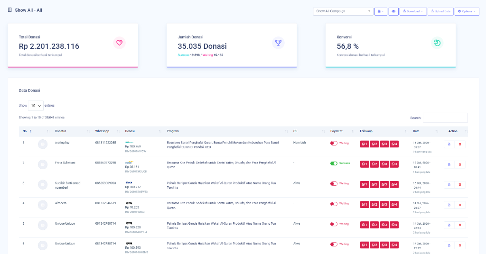
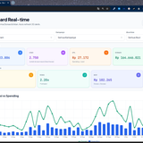

# Muhamad Aldi Wiyono

### Kepala Divisi Digital Marketing · Masjid Muslim Billionaire

📍 Bogor, Indonesia  
📧 [aldi32350@gmail.com](mailto:aldi32350@gmail.com)  
📱 [0812-1249-6362](https://wa.me/6281212496362)

---

## 👋 Tentang Saya

Halo, saya **Muhamad Aldi Wiyono**. Saat ini saya menjabat sebagai **Kepala Divisi Digital Marketing di Masjid Muslim Billionaire, Bogor**. Berawal dari semangat pengabdian dan belajar langsung di lapangan, kini saya memimpin strategi konten, periklanan digital (Meta Ads & Google Ads), dan pengembangan web untuk membantu menyebarkan dakwah serta program-program kebaikan masjid ke audiens yang lebih luas.

---

## 🛠️ Keahlian

| Bidang | Deskripsi |
|---|---|
| 🎯 **Content Ads Mastery** | Membuat konten iklan yang menarik dan sesuai target audiens |
| 📢 **Advertiser** | Mengelola dan mengoptimalkan kampanye iklan digital (Meta Ads & Google Ads) |
| 🧠 **Content Strategy** | Merencanakan dan menyusun strategi konten yang terarah |
| 💻 **Web Developer** | Membangun dan mengelola website |

**Tools & AI yang digunakan:**

`Meta Ads` · `Google Ads` · `Instagram` · `TikTok` · `Canva` · `CapCut` · `ChatGPT` · `Claude AI` · `Gemini AI`

---

## 💼 Pengalaman Kerja

### Kepala Divisi Digital Marketing
**Masjid Muslim Billionaire, Bogor** · 2024 – Sekarang

- Memimpin dan menyusun strategi digital marketing masjid secara menyeluruh
- Merancang serta mengoptimalkan kampanye iklan berbayar (Meta Ads & Google Ads) untuk kajian akbar dan program wakaf
- Mengoordinasikan produksi konten kreatif media sosial harian
- Mengembangkan dan mengelola website profil serta landing page kegiatan masjid

### Santri On Duty / Staf Digital Marketing
**Masjid Muslim Billionaire, Bogor** · 2022 – 2024

- Mengelola kegiatan harian media sosial masjid
- Memproduksi video pendek (Reels/TikTok) dan materi grafis promosi
- Menjalankan iklan digital untuk memperluas jangkauan kegiatan masjid

---

## 🎓 Pendidikan

| Periode | Institusi |
|---|---|
| **2021 – Sekarang** | Pondok CEO Bogor |
| **2019 – 2021** | STMIK Pringsewu, Lampung (hingga Semester 3) |
| **2017 – 2019** | MA Muhammadiyah Kalirejo, Lampung Tengah |

---

## 🚀 Proyek Pilihan

> Bagian ini adalah **yang paling penting** dalam portofolio. Isi dengan hasil kerja nyata Anda.

### 1. Kampanye Iklan Donasi & Wakaf Produktif (Tembus Rp 2,2 Miliar)
- **Peran:** Lead Digital Ads Strategy & Conversion Specialist
- **Platform:** Meta Ads (Facebook & Instagram), Google Ads, WhatsApp Funnel
- **Deskripsi:** Pengelolaan periklanan digital berbayar untuk program Beasiswa Santri Penghafal Al-Qur'an Pondok CEO, Sedekah Yatim/Dhuafa, dan Wakaf Al-Qur'an Produktif Masjid Muslim Billionaire.
- **Hasil Nyata:**
  - **Total Donasi:** Rp 2.201.238.116
  - **Jumlah Transaksi:** 35.035 donasi tercatat (19.898 sukses)
  - **Tingkat Konversi:** 56,8%
- 🔗 [Lihat Dashboard](pencapaian_ads_dashboard.png)

### 2. Sistem Manajemen Digital Marketing & Dashboard Real-Time
- **Peran:** Digital Marketing System Architect & Campaign Analyst
- **Bukti Tampilan:** `bukti_system_management.png` (Dashboard Real-Time Auto-Refresh 30 Detik)
- **Fitur:** Pemantauan Multi-Kampanye & Multi-Akun, Kontrol Pengeluaran Iklan, Grafik Spend vs Revenue
- **Hasil Nyata:**
  - **Omset Terpantau:** Rp 164.046.021
  - **Rata-rata ROAS:** 2.28x
  - **Rata-rata CTR:** 2.75%
  - **Pembaruan Data:** Auto-Refresh 30 Detik secara otomatis
- 🔗 [Lihat Dashboard](bukti_system_management.png)

### 3. Website Resmi Masjid Muslim Billionaire (masjidmuslimbillionaire.com)
- **Peran:** Web Developer (UI/UX Design & Frontend Development)
- **Domain Resmi:** [masjidmuslimbillionaire.com](https://masjidmuslimbillionaire.com)
- **Bukti Tampilan:** `bukti_website_masjid.png` (Tampilan Live Halaman Profil & Baitul Maal)
- **Teknologi:** HTML5, CSS3, JavaScript, Responsive Mobile-First
- **Deskripsi:** Pembangunan dan pengelolaan website resmi masjidmuslimbillionaire.com dari awal sebagai portal pusat informasi digital jamaah, jadwal sholat harian, agenda kajian akbar rutin, serta sistem donasi dan infaq yang ringan dan cepat dibuka dari HP.
- **Hasil Nyata:** Waktu loading di bawah 1 detik (< 1.0s), 100% responsif di ponsel, memudahkan ribuan jamaah mengakses informasi masjid secara mandiri.
- 🔗 [Kunjungi Website Live](https://masjidmuslimbillionaire.com)

### 3. Rencana Konten Harian & Video Reels Dakwah
- **Peran:** Content Creator & Video Editor
- **Akun Resmi:** [@aldi.wiyono](https://www.instagram.com/aldi.wiyono/)
- **Tools:** CapCut, Canva, Instagram, TikTok
- **Deskripsi:** Menyusun jadwal postingan sebulan penuh dan memproduksi video pendek reels di CapCut. Mengangkat sisi humanis keseharian santri dan marbot, inspirasi dakwah, serta ajakan kebaikan yang santai.
- **Hasil Nyata:** Interaksi akun melonjak hingga +140%, viewers tembus 45.2K views.
- 🔗 [Lihat Akun Instagram](https://www.instagram.com/aldi.wiyono/)

---

## 🏆 Sertifikat & Pelatihan

- [Nama Sertifikat / Pelatihan] — _Penyelenggara, Tahun_
- [Nama Sertifikat / Pelatihan] — _Penyelenggara, Tahun_

---

## 📬 Kontak

Tertarik bekerja sama atau ingin berdiskusi? Hubungi saya:

- 📧 Email: [aldi32350@gmail.com](mailto:aldi32350@gmail.com)
- 📱 WhatsApp: [0812-1249-6362](https://wa.me/6281212496362)
- 📸 Instagram: [@aldi.wiyono](https://www.instagram.com/aldi.wiyono/)
- 🌐 Website Resmi: [masjidmuslimbillionaire.com](https://masjidmuslimbillionaire.com)

---

_Terima kasih sudah berkunjung! 🙏_

